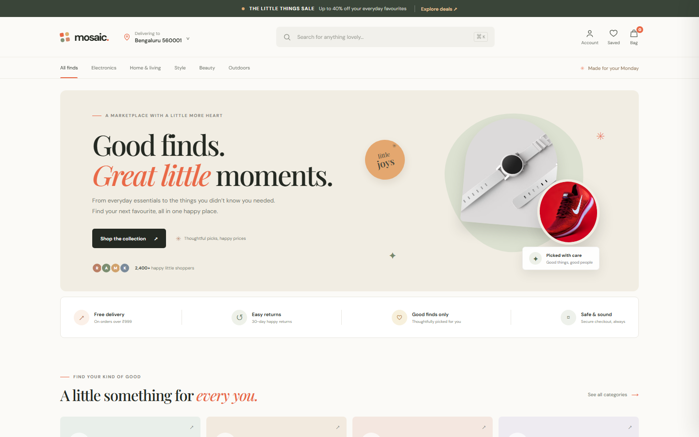

<div align="center">

# 🛍️ Mosaic Market

### *Good finds. Great little moments.*

A responsive, modern marketplace storefront built with **React 19** and **Vite**: search, filters, favorites, and a working shopping bag.

[](https://mosaic-market-alpha.vercel.app/)


**[🌐 Live Store](https://mosaic-market-alpha.vercel.app/)** · **[🐛 Report Bug](https://github.com/digvijay165/mosaic-market/issues)** · **[✨ Request Feature](https://github.com/digvijay165/mosaic-market/issues)**

<br>

<a href="https://mosaic-market-alpha.vercel.app/">
  
</a>

</div>

---

## 📖 About

**Mosaic Market** is a front-end e-commerce storefront inspired by large online shopping sites, with its own name and visual identity. It has a **44-product sample catalog** across five departments (Tech & gadgets, Home & living, Style, Beauty, and Outdoors) wrapped in a warm, editorial design.

> 🔗 **Try it live:** [mosaic-market-alpha.vercel.app](https://mosaic-market-alpha.vercel.app/)

---

## ✨ Features

| Feature | Description |
| --- | --- |
| 🔍 **Instant search** | Search by name, category, or description. Press <kbd>Ctrl</kbd> + <kbd>K</kbd> / <kbd>⌘</kbd> + <kbd>K</kbd> to jump to search |
| 🗂️ **Department browsing** | Filter across Electronics, Home, Fashion, Beauty, and Outdoors |
| ↕️ **Sorting** | Sort products by price or rating |
| 🔎 **Product details** | Quick-view modal with images, rating, and description |
| ❤️ **Favorites** | Save products you love, kept across visits |
| 🛒 **Shopping bag** | Add items, change quantities, remove products, and see the subtotal |
| 🚚 **Free-delivery reminder** | Shows how close you are to free delivery on orders over **₹999** |
| 💳 **Demo checkout** | Complete a front-end checkout flow |
| 📰 **Newsletter** | Working sign-up form (front-end demo) |
| 💾 **Persistent state** | Cart and favorites saved in `localStorage` |
| 📱 **Fully responsive** | Polished on mobile, tablet, and desktop |

---

## 🛠️ Tech Stack

- **React 19**: component-based UI
- **Vite 7**: fast dev server and production build
- **JavaScript (ES Modules)**: storefront logic and state
- **CSS3**: custom responsive styling, no UI framework
- **Unsplash**: product photography
- **Vercel**: hosting and continuous deployment

---

## 📁 Project Structure

```
mosaic-market/
├── index.html            # App entry HTML
├── package.json          # Scripts and dependencies
├── pnpm-lock.yaml
├── pnpm-workspace.yaml
└── src/
    ├── App.jsx           # Components, catalog data, and storefront behavior
    ├── main.jsx          # React entry point
    └── styles.css        # Responsive visual styles
```

---

## 🚀 Getting Started

### Prerequisites

- **Node.js** 20.19+ or 22.12+
- **pnpm** (recommended) or npm

### Installation

```bash
# Clone the repository
git clone https://github.com/digvijay165/mosaic-market.git
cd mosaic-market

# Install dependencies
pnpm install

# Start the dev server
pnpm dev
```

Open the local URL printed by Vite (usually `http://localhost:5173`).

> 💡 Prefer npm? Use `npm install` and `npm run dev` instead.

### Available Scripts

| Command | Description |
| --- | --- |
| `pnpm dev` | Start the local development server |
| `pnpm build` | Build for production into `dist/` |
| `pnpm preview` | Preview the production build locally |

---

## 🌐 Deployment

The live site is deployed on **Vercel** and redeploys automatically on every push to `main`.

| Setting | Value |
| --- | --- |
| Live URL | [mosaic-market-alpha.vercel.app](https://mosaic-market-alpha.vercel.app/) |
| Framework | Vite |
| Build command | `pnpm build` |
| Output directory | `dist` |

The `dist/` folder can also be deployed to any static host (Netlify, GitHub Pages, Render, etc.).

---

## ⚠️ Demo Notes

Mosaic Market is a **front-end demonstration**:

- The catalog and prices are sample data in `src/App.jsx`
- Cart and saved items stay in the current browser
- Checkout, account, newsletter, delivery, and payment are **UI demos only**; no orders or data are sent to a server
- Product photos load from Unsplash, so an internet connection is needed

---

## 🗺️ Roadmap

- [ ] Backend API and real product database
- [ ] User accounts and order history
- [ ] Payment gateway integration
- [ ] Product reviews and ratings
- [ ] Wishlist sharing

---

## 🤝 Contributing

Contributions, issues, and feature requests are welcome!

1. Fork the project
2. Create your branch (`git checkout -b feature/AmazingFeature`)
3. Commit your changes (`git commit -m "Add AmazingFeature"`)
4. Push to the branch (`git push origin feature/AmazingFeature`)
5. Open a Pull Request

---

## 👤 Author

**Digvijay Singh**
- GitHub: [@digvijay165](https://github.com/digvijay165)
- Portfolio: [digvijay165.github.io/portfolio](https://digvijay165.github.io/portfolio/)

---

<div align="center">

⭐ **If you like this project, give it a star!** ⭐

Made with ❤️ by [Digvijay Singh](https://github.com/digvijay165)

</div>
